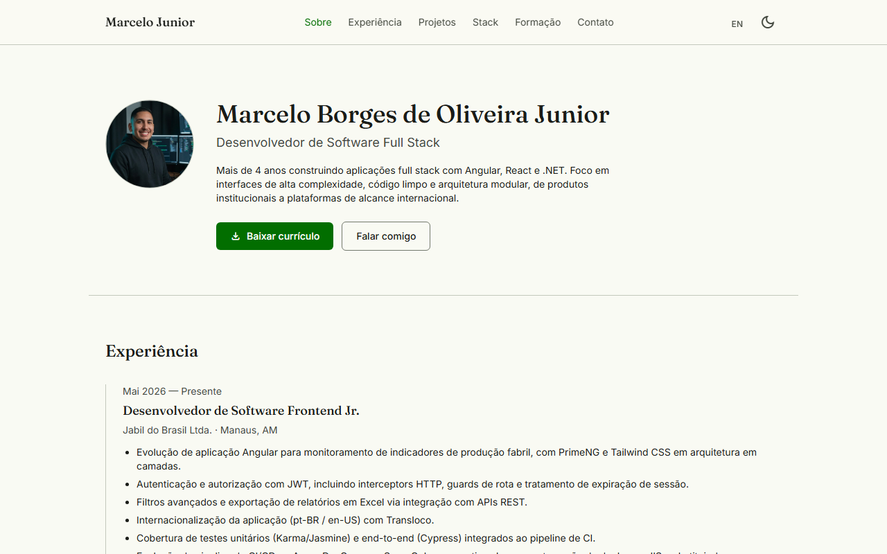
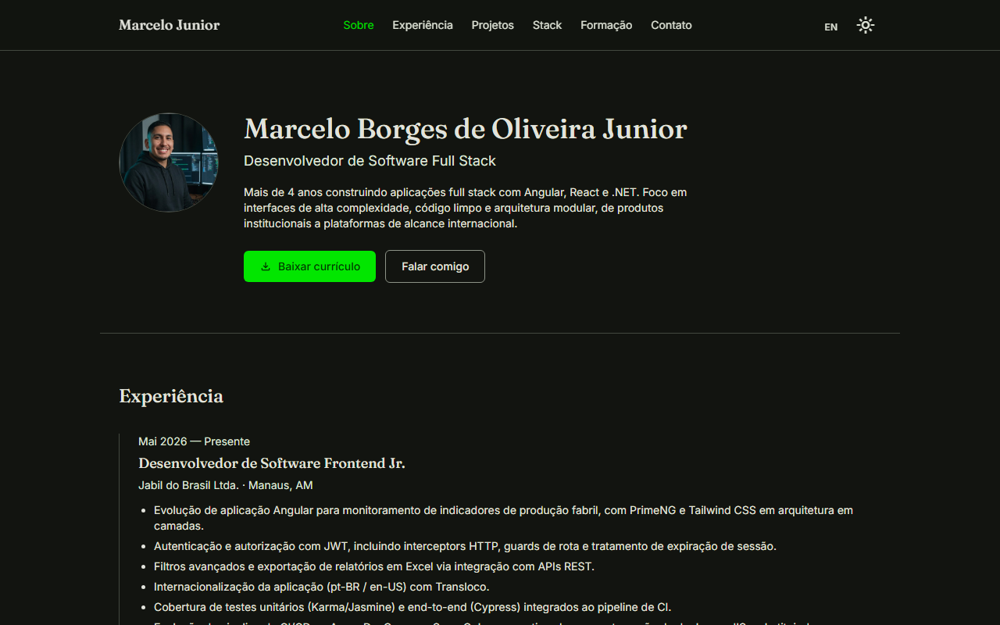
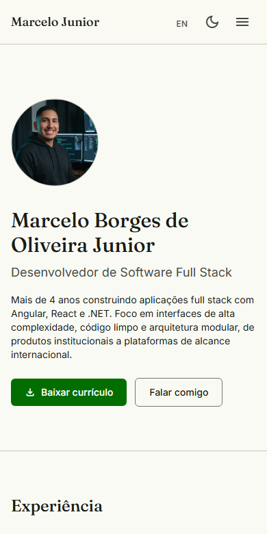
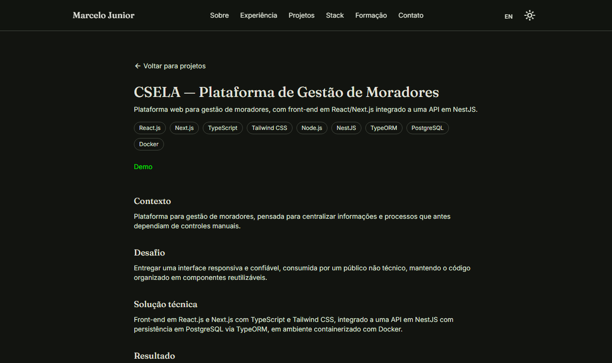

<div align="center">

# Marcelo Borges — Portfolio

Single-page developer portfolio, prerendered to static HTML. Built from the functional requirements in [`docs/FRD – Portfólio Online.md`](<docs/FRD – Portfólio Online.md>).

**[marcelodev-nu.vercel.app](https://marcelodev-nu.vercel.app/)**

[](https://angular.dev)
[](https://www.typescriptlang.org/)
[](https://tailwindcss.com)
[](https://material.angular.io)
[](https://jsverse.github.io/transloco/)

</div>

## Screenshots

<table>
<tr>
<td width="50%"></td>
<td width="50%"></td>
</tr>
<tr>
<td align="center"><sub>Light theme</sub></td>
<td align="center"><sub>Dark theme</sub></td>
</tr>
</table>

<table>
<tr>
<td width="32%"></td>
<td width="68%"></td>
</tr>
<tr>
<td align="center"><sub>Mobile</sub></td>
<td align="center"><sub>Project detail page</sub></td>
</tr>
</table>

## Features

- Single-page layout — about, experience, projects, stack, education and contact, with a fixed nav that scroll-spies the active section
- Dedicated detail page per featured project (context, challenge, solution, result)
- Dark / light theme, persisted per visitor
- Portuguese / English language switch (Transloco), persisted per visitor — all content and UI strings, not just labels
- Contact form wired to Formspree, with client-side validation and success/error states
- SEO: per-route `<title>`/description/Open Graph tags, JSON-LD `Person` schema, `robots.txt`, `sitemap.xml`
- Fully static output — every route is prerendered at build time, no Node server in production

## Tech stack

| Layer      | Choice                                               |
| ---------- | ----------------------------------------------------- |
| Framework  | Angular 22 — standalone components, Signals            |
| Styling    | Tailwind CSS v4 + Angular Material (custom M3 theme)    |
| i18n       | Transloco, synchronous loader (SSR/prerender-safe)      |
| Forms      | Formspree                                               |
| Rendering  | Angular SSR with `outputMode: "static"` (build-time prerender) |
| Testing    | Vitest + Angular's unit-test builder                    |
| Lint       | ESLint (`@angular-eslint`)                               |
| CI         | GitHub Actions (lint → test → build)                      |

## Getting started

```bash
npm install
npm start
```

Open `http://localhost:4200`.

## Build

```bash
npm run build
```

Output goes to `dist/Portfolio-Marcelo/browser` — a fully static site (no Node server needed), ready to deploy to Vercel, Netlify, Cloudflare Pages or any static host.

## Tests & lint

```bash
npm test
npm run lint
```

## Editing content

All real content (profile, experience, projects, education, tech stack) lives in typed files under `src/app/core/data/` — editing the site means editing data, not components:

- `profile.data.ts` / `profile.en.data.ts`
- `experience.data.ts` / `experience.en.data.ts`
- `projects.data.ts` / `projects.en.data.ts`
- `education.data.ts` / `education.en.data.ts`
- `technologies.data.ts` (tech names are shared between languages)

UI strings (labels, buttons, validation messages — not content) live in `src/app/core/i18n/pt.json` and `en.json`.

## Deployment

Live on Vercel at [marcelodev-nu.vercel.app](https://marcelodev-nu.vercel.app/), built from `dist/Portfolio-Marcelo/browser` — fully static, no server-side runtime. The contact form endpoint lives in `src/app/core/data/contact.config.ts` (Formspree).

## CI

`.github/workflows/ci.yml` runs lint, tests and build on every push/PR to `main`.
